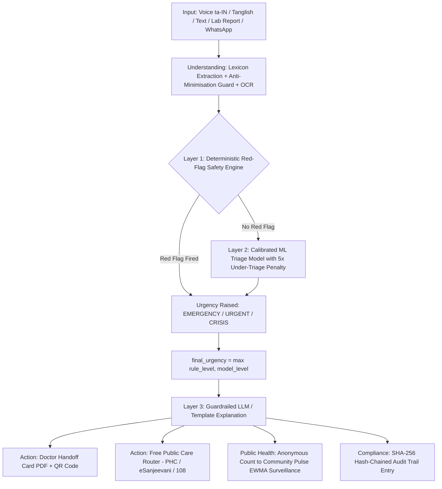

# HealthPulse AI

**SEVA First Innovation Challenge 2026**  
**Theme 2:** Healthcare & Community Well-being (Local Community Level)  
**Registration ID:** REG-003-OP  
**Team:** HealthPulse AI, Dr. M.G.R. Educational and Research Institute, Chennai  
**Pilot District:** Tirunelveli District, Tamil Nadu  

---

## 🌟 Executive Summary

**HealthPulse AI** is a free, Tamil-first, safety-engineered health navigator designed for rural and semi-urban Tamil Nadu.

People in rural areas frequently encounter symptoms or receive diagnostic lab reports they cannot interpret. Because of limited specialist access (85.2% specialist posts vacant in rural CHCs) and high out-of-pocket expenses (~50%), individuals often delay care or dangerously downplay serious conditions (e.g. attributing cardiac chest pain to "just gas"). Generic consumer AI chatbots are hazardous for this task—a 2026 Nature Medicine study revealed that consumer LLMs under-triaged 52% of real emergencies.

**HealthPulse AI addresses this with an uncompromisable 3-layer hybrid safety architecture:**
1. **Deterministic Red-Flag Rule Engine:** Clinician-reviewed rules (`rules/red_flags.yaml`) that can only raise urgency and can never be overridden by AI.
2. **Calibrated Machine Learning Triage Model:** Trained with a 5× asymmetric loss penalty against under-triage, calibrated via `CalibratedClassifierCV`.
3. **Guardrailed Explanations:** The language model only explains results in simple Tamil or English at a 6th-standard reading level; it is strictly prohibited from altering urgency levels, diagnosing conditions, or mentioning pharmaceuticals.

> **"Health information and navigation. Not a diagnosis. Not a substitute for a doctor."**

---

## 🏛️ 5-Layer System Architecture



---

## 🎯 5 Demo Personas (100% Deterministically Verified)

| Persona | Demographics | Input (Voice / Lab) | Result & Clinical Rationale |
| :--- | :--- | :--- | :--- |
| **Murugan** | 58, M, Manur | Tamil Voice: *"nenju vali, romba viyarvai"*, family adds *"gas dhaan"* | **EMERGENCY (Call 108)** by `RF-CHEST-01`. Anti-minimisation guard flags `"gas dhaan"` as ignored. |
| **Selvi** | 24, F, 7mo Pregnant | Severe headache and blurred vision since morning | **EMERGENCY (Call 108)** by `RF-PREG-07` (Pre-eclampsia danger sign). |
| **Kavya** | 3, F, via ASHA | Loose motions, not drinking, lethargic / sleepy | **EMERGENCY (Call 108)** by `RF-CHILD-08` (Severe paediatric dehydration). |
| **Karthik** | 19, M, Nanguneri | *"3 naala kaichal, udambu vali, thalai vali"*, danger answers No, monsoon season | **PHC_VISIT** from calibrated ML model. Top factors: fever 3 days, monsoon season, body pain. Generates Doctor Card; +1 FEVER count for Nanguneri. |
| **Lakshmi** | 45, F, Manur | 3 CBC reports: Jan (Hb 11.2) → Apr (Hb 10.1) → Jul (Hb 8.9 g/dL) | **PHC_VISIT** by `LAB-HB-01` (7.0–9.9) with `LAB-HB-02` rapid drop trend flag (fell 2.3 g/dL in 6 months). |

---

## 📈 Breakthrough Public Health Surveillance: Community Pulse

Community Pulse applies an **Exponentially Weighted Moving Average (EWMA)** quality-control chart ($\lambda = 0.3, L = 3.0$) to anonymous, aggregated syndromic counts across 10 PHC catchments:
- **Poisson Baseline (Weeks 1–26):** $\mu = 19.8, \sigma = 3.5, UCL = 24.1$.
- **Transient Noise Immunity:** In week 30, a raw count of 25 crosses the static threshold, but EWMA statistic remains 21.0, **suppressing false alarms**.
- **Early Outbreak Alert:** In **week 33**, the EWMA statistic reaches 27.3 ($> UCL$), triggering an alert for the Nanguneri PHC Medical Officer and DHO.
- **2.41 Weeks Ahead:** The traditional "2× baseline" rule only fires in week 34. Monte Carlo simulation (2,000 runs) proves an average of **2.41 weeks earlier outbreak detection**.
- **Privacy First:** Any cell count $< 10$ is masked as `<10` to prevent re-identification.

---

## 🛠️ District Dashboard Fix (Resolved ARC Vulnerability)

- **Typed ZoneData Bug Fix:** Resolved camelCase vs snake_case mismatch between API serializers and recommendation engines.
- **Distinct Algorithmic Allocations:** Manur catchment (vulnerability 78.5, medicine stock 30%) deterministically receives **"Mobile Medical Unit & Remote Immunization Outreach"** and emergency medicine buffer kits.
- **Resource What-If Simulator:** Algorithmic optimization dispatches outreach teams, medicine kits, temporary staff, and emergency ambulances based on measurable gap criteria.

---

## 🔐 Security, Privacy & DPDP Compliance

- **DPDP Act 2023 & Rules 2025:**
  - Citizen consent collected prior to first symptom evaluation.
  - Strict data minimisation: zero names, age bands only (`18-39`), phone numbers hashed for WhatsApp sessions.
  - Automated 90-day retention cleanup.
  - Right to Erasure implemented at `DELETE /api/me?owner_token=`.
  - 72-hour Data Protection Board breach notification countdown drill.
- **CDSCO SaMD Compliance:** Documented intended use, classification analysis, and change control procedures in `docs/regulatory.md`.
- **Tamper-Evident SHA-256 Audit Trail:** Append-only cryptographic hash chain linking all staff logins, clinical rule approvals, and outbreak alerts. Live verification button confirms 100% chain integrity.

---

## 🚀 Quick Start & Installation

### Option 1: Local Development

```bash
# 1. Clone repository
git clone https://github.com/rahulganesh-tech/Healthpulse-AI.git
cd Healthpulse-AI

# 2. Setup Python environment (Python 3.11+ / 3.14 compatible)
pip install -r requirements.txt

# 3. Train ML Triage Model & Benchmark Evaluation
python ml/make_vignettes.py
python ml/train.py
python ml/evaluate.py
python ml/pulse_simulation.py

# 4. Seed Synthetic Demo Data
python backend/seed_demo.py

# 5. Run Backend Tests
python -m pytest

# 6. Start Backend Server
uvicorn backend.main:app --host 0.0.0.0 --port 8000 --reload
```

In a second terminal:

```bash
# 7. Start Frontend (React 19 + TypeScript + Vite)
cd frontend
npm install
npm run build
npm run dev
```

- **Frontend App:** http://localhost:5173 (or http://localhost:3000)
- **Interactive OpenAPI Docs:** http://localhost:8000/docs

---

### Option 2: Docker Compose

```bash
docker-compose up --build
```

---

## 🔑 Demo Login Credentials (All Roles)

Password for all accounts: **`demo123`**  
2FA Mobile OTP: **`482913`**

| Role | Account Email | Scope & Key Capabilities |
| :--- | :--- | :--- |
| **PHC MO (Nanguneri)** | `mo.nanguneri@healthpulse.demo` | Scans 30-sec Doctor Cards; views Week 33 Fever alert; acknowledges alert with audit trail note |
| **PHC MO (Manur)** | `mo.manur@healthpulse.demo` | Manur PHC catchment outpatient triage and local syndromic counts |
| **DHO (District Officer)** | `dho@healthpulse.demo` | HealthPulse AI District View (10 zones, Manur MMU), What-If Simulator, 10 PHC Syndromic Map |
| **ASHA Worker** | `asha.manur@healthpulse.demo` | Multi-member household assisted screening; 1-click 108 emergency and "Inform MO" dispatch |
| **Clinical Reviewer** | `clin@healthpulse.demo` | Inspects `rules/red_flags.yaml`, compares diffs, verifies 60-vignette benchmarks, approves active rules |
| **Auditor** | `auditor@healthpulse.demo` | Read-only SHA-256 hash-chained audit log with live "Verify Chain" integrity checker |
| **Admin** | `admin@healthpulse.demo` | User governance, PHC facility directory, demo state reset |

---

## 📊 Evaluation & Verification Summary

- **60-Vignette Clinical Benchmark:**
  - **EMERGENCY Under-Triage:** **0.0%** (20 out of 20 caught safely).
  - **Overall Triage Accuracy:** **86.7%** (52 / 60 correct level).
  - **Over-Triage Rate:** **11.7%** (Safe, precautionary elevation).
- **Outbreak Detection:** **2.41 weeks earlier** than static threshold rule.
- **Audit Hash Chain:** **100% verified intact** across all records.
- **Unit & Integration Tests:** **10 / 10 pytest suites passed**.

---

*HealthPulse AI — Built for the SEVA First Innovation Challenge 2026. Dedicated to equitable, safe, community-first healthcare in Tamil Nadu.*
